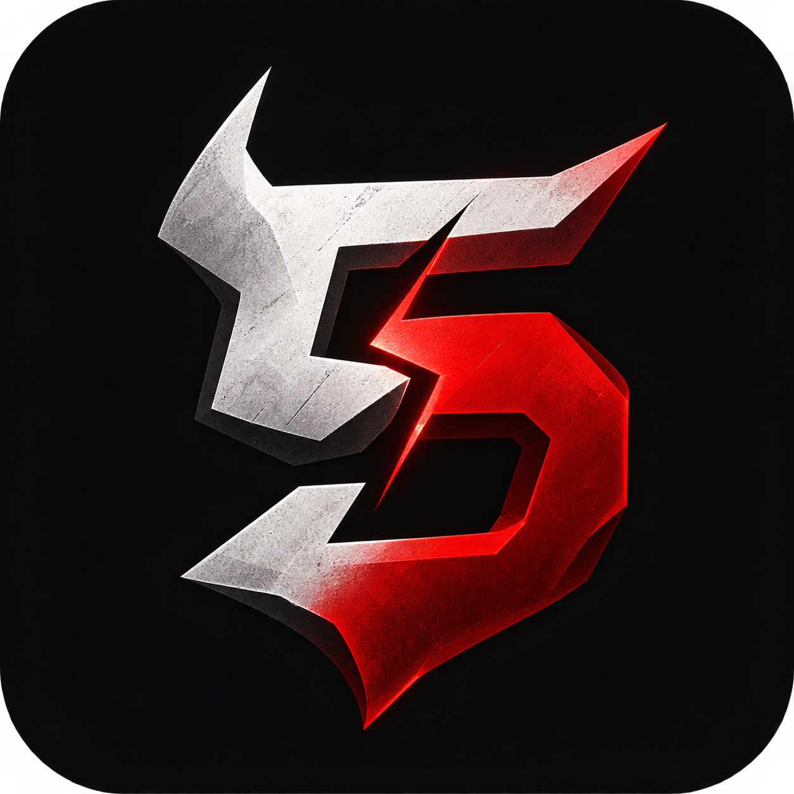

  <!-- Logo Principal -->
  
  
  <h1>CLASH 5 (C5)</h1>
  
<b>O Hero Shooter Tático 5v5 Definitivo para Mobile.</b>

  
  <!-- Badges de Tecnologia e Status -->
  

    
    
    
    
  

  
  <!-- Botões de Ação (CTA) -->
  <h3>
    <a href="https://aad-systems.github.io/clash5-official/">🌐 ACESSAR O SITE OFICIAL</a> • 
    <a href="https://discord.gg/RfFgpaTk9E">💬 ENTRAR NO DISCORD</a>
  </h3>

 

> 📌 **Sobre este Repositório**
> Este repositório hospeda exclusivamente a **Landing Page e o Portal de Suporte** do CLASH 5. O código-fonte do jogo é um software proprietário (*Closed Source*) e não está disponível publicamente.

---

## 🎮 O Jogo

**CLASH 5** é um Hero Shooter em terceira pessoa (TPS) focado em partidas rápidas e intensas de 5v5 para dispositivos móveis. 

Escolha seu Operador, domine o poder da **Ressonância** (magia tecnológica) para destruir a arena, mas lembre-se da regra de ouro do jogo: **Toda habilidade devastadora exige um sacrifício tático.**

### ⚙️ Principais Mecânicas
*   📱 **Mobile-First Design:** Controles fluidos com Joystick flutuante e sistema de Auto-Shoot, otimizados para rodar a 60 FPS em dispositivos intermediários.
*   ⚖️ **O Preço do Poder:** Não existem heróis invencíveis. Usar sua Ultimate pode virar o jogo, mas aplicará uma penalidade severa no seu personagem (Ex: Perda de vida, lentidão, perda de mira).
*   🏆 **Ecossistema Competitivo:** Modos casuais (Caçada, Carga), guerras de clãs (Ascensão) e o circuito profissional (Circuit C5).
*   🤖 **Comunidade Integrada:** Matchmaking automatizado e estatísticas em tempo real via bot oficial no Discord.

---

## 🛠️ Stack Tecnológico (Web Portal)
O site e a página de suporte foram construídos com foco em performance extrema e design responsivo:
*   **HTML5 / CSS3 Puro** (Zero dependência de frameworks pesados para garantir carregamento instantâneo).
*   **JavaScript Vanilla** (Integração com Webhooks do Discord para o sistema de suporte).
*   **GitHub Pages** para hospedagem contínua.

---

## 🛡️ ASX3 Studios
A **ASX3 Studios** é um estúdio independente focado no desenvolvimento de experiências competitivas de alta qualidade para dispositivos móveis. Fundada com o objetivo de criar jogos que respeitam o tempo e a habilidade do jogador.

---

## ⚠️ Propriedade Intelectual e Copyright

**© 2024 ASX3 Studios. Todos os direitos reservados.**

*   **Closed Source:** O jogo CLASH 5, incluindo suas mecânicas, personagens, lore e código de engine, é propriedade exclusiva da ASX3 Studios.
*   **Assets do Repositório:** As imagens, logos, design de interface e códigos de front-end contidos neste repositório não podem ser copiados, modificados, distribuídos ou utilizados comercialmente sem a autorização prévia e por escrito da ASX3 Studios.
*   **Isenção de Responsabilidade:** Este repositório não contém o cliente do jogo para download. Links falsos ou clones não são de responsabilidade do estúdio.
